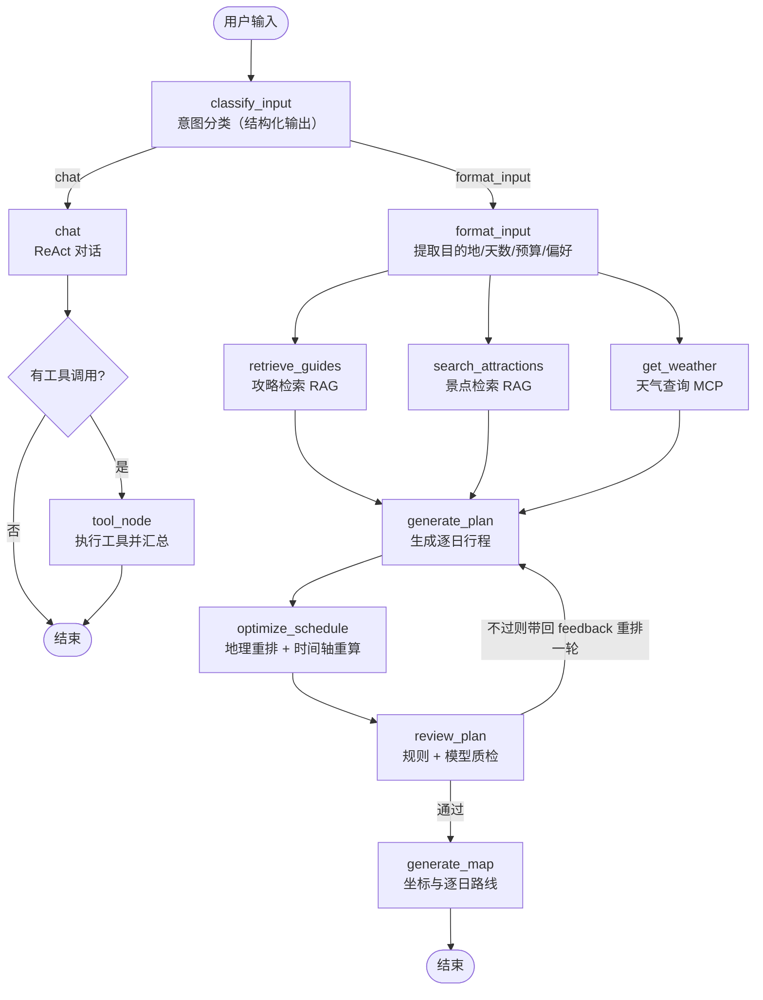

# TripGenie · 智能旅行规划助手

用一句自然语言描述旅行需求，系统自动完成 **需求解析 → 攻略检索 → 景点搜索 → 天气查询 → 生成逐日行程 → 渲染地图路线**，并以 SSE 流式输出实时展示 Agent 的中间思考过程。

个人项目，目标是完整跑通一个 LLM Agent 的工程化闭环：**工作流编排、工具接入、检索增强、流式输出、状态持久化**。

---

## 界面预览

一句话说清想怎么玩，剩下的交给它：


目的地或天数没给准时不会硬猜，先把条件摆出来让人拍板——错了就改，别浪费一次规划：


确认后并行检索攻略/景点/天气，生成行程并通过质检，再出卡片：


点开看逐日安排，每天附一张当天路线的地图（折线来自高德驾车路径规划，不是两点连直线）：


---

## 功能特性

### 1. 意图识别与双分支路由

入口节点用 LLM 的**结构化输出**（`with_structured_output` + `Literal["chat", "format_input"]`）判断用户意图，再由条件边路由，而不是靠关键词匹配堆 if-else。

- **chat 分支**：闲聊或单一工具诉求（天气、景点、交通、美食）。走标准 ReAct 循环——模型自主决定调用哪些工具，工具结果回灌后再由模型汇总成自然语言回复，单轮支持多工具并发调用。
- **format_input 分支**：多天行程规划这类复杂任务，进入下方的规划链路。

### 2. 行程规划：并行检索 + 汇聚生成

需求解析节点把自然语言拆成结构化字段（目的地 / 天数 / 预算 / 偏好），然后**扇出到三个互相独立的节点并行执行**：

- `retrieve_guides` —— 从攻略库做 RAG 检索
- `search_attractions` —— 从景点库做 RAG 检索
- `get_weather` —— 通过 MCP 工具查天气

三者全部完成后**汇聚**到 `generate_plan`，把检索结果、天气、预算等一起喂给模型，用流式方式生成结构化行程 JSON（逐日活动、时间、花费、备注、贴士）。

### 3. 行程排程：LLM 定"去哪"，求解器定"几点到"

LLM 生成行程时**不做时间算术**：它给的是"看起来合理"的数字。基线实测 15 条历史行程，
**33.7% 的相邻活动间隔不足 15 分钟，33.2% 干脆首尾相接**（上一个 10:30 结束，下一个
10:30 开始），而现有质检规则只能发现 1/15 条。

所以在 `generate_plan` 和 `review_plan` 之间插了一个确定性排程节点：

1. **同天景点按地理重排**：最近邻 + 2-opt，避免"东一头西一头"；
2. **时间轴重算**：从 09:00 起逐段加上通勤时间（球面距离 × 道路曲折系数 + 10 分钟进出场开销），午饭不早于 11:30、晚饭不早于 17:30，且各有最晚上限——晚饭最晚 19:00 开始，排在它前面的景点必须在此之前结束；
3. **塞不下的活动先尝试跨天再平衡**：当天排不下的活动挪到还有余量的另一天（只在"挪过去也不丢活动"时接受）；确实无处安放才写进 `state["schedule_dropped"]`，并在 tips 里告知用户"这个点没排进去"，而不是给一个物理上到不了的时间。

边界很明确：**去哪几个景点仍由 LLM 决定**（语义选择），排程只负责顺序和钟点。
排程失败、拿不到坐标都保留原始顺序继续往下走——它是增强项，不是必经关卡。

同一批 8 条历史行程离线回放（只换排程逻辑，不重新调模型，覆盖 95 个活动衔接）：

| 指标 | 改造前 | 改造后 |
|---|---|---|
| 短间隔占比 | 28.4% | **0.0%** |
| 日均驾车（中位） | 51.5 min | **31.5 min** |
| 排到 20:00 之后的天数 | 2 | **0** |
| 被移出的活动 | — | 6（跨天再平衡后剩余） |

复现：`cd backend && python scripts/schedule_baseline.py --replay`

### 4. 行程地图可视化

生成的行程文本本身不含坐标，需要一次**反向结构化**：

1. 用 LLM 从行程中抽取"值得参观的景点/地标"，并标注它出现在第几天
2. 并发调用高德地理编码拿经纬度（**REST 优先、MCP 兜底**；城市名 + 景点名组合搜索以提高命中率，并发度见 `MAP_CONCURRENCY`）
3. 调用驾车路径规划生成路线，拿到 polyline、距离与耗时
4. 前端按天渲染独立地图：编号 marker + 彩色路线 + 距离/耗时列表

工程上处理了几个实际问题：**跨天不生成路线**（避免画出"第 1 天景点 → 第 2 天景点"的假路线）；MCP 返回格式在不同工具间不一致，做了多层兼容解析并在 JSON 解析失败时降级为正则提取；地理编码失败时回落到估算位置并标记 `approx`，前端用灰色区分。

地理编码和驾车路线都改成 **REST 直连优先**，MCP 只作兜底。原因不是"REST 更新"，而是 MCP 调用**没有超时**：它挂在 stdio 子进程上，响应一旦丢失就永久挂起。并发化之后这个缺陷被放大——七天云南行程（27 个景点）曾在评测里卡满 300 秒，被外层超时杀掉。REST 一次 50~150ms、能设 timeout，MCP 兜底那条路径额外加了锁和 10 秒超时。

### 5. MCP 协议接入外部工具

通过 `langchain-mcp-adapters` 的 `MultiServerMCPClient`，以 **stdio** 方式拉起两个 MCP Server：

| MCP Server | 用途 |
|---|---|
| `amap-mcp-server` | 高德地图：地理编码、路径规划 |
| `mcp-server-time` | 时间查询（本地时区 Asia/Shanghai） |

MCP 工具与自研工具（RAG 检索、天气查询）合并成统一工具集交给模型调度，并支持按名称屏蔽指定工具。新增工具只需改工具注册处，**不必改动工作流定义**。

### 6. 全链路流式输出与"思考链"

后端基于 `workflow.astream_events(version="v2")` 捕获节点级事件，包装成自定义 SSE 协议下发：

| 事件 | 含义 |
|---|---|
| `thread_id` | 会话 ID（新会话时由后端生成） |
| `node_start` / `node_end` | 某个工作流节点开始/结束 |
| `chunk` | 模型流式输出的文本片段 |
| `trip_plan` | 结构化的完整行程（含地图数据） |
| `done` / `error` | 结束或异常 |

前端不依赖任何 SSE 库，用 `fetch` + `ReadableStream` + `TextDecoder` 手工解析分帧（因为原生 `EventSource` 只支持 GET，无法带 JSON body）。节点事件被渲染成可折叠的"思考过程"时间线，文本片段进缓冲区后按固定速率平滑打印，避免网络抖动造成的一顿一顿。

### 7. 多轮会话与历史回放

- **图状态持久化**：LangGraph `AsyncSqliteSaver` 按 `thread_id` 做检查点，多轮对话能接上上下文
- **业务侧存储**：另建 SQLite 的 `sessions` / `messages` 表管理会话列表（含索引、级联删除、按首条用户消息自动生成会话名）
- **历史回放**：行程产生的地图数据以 JSON 存进消息表，重新打开历史会话时地图能原样恢复

### 8. 账号体系与数据隔离

- **登录门禁**：未登录时前端直接弹登录窗（遮罩 + 卡片，不可关闭），登录后才能发消息；令牌有效则刷新页面仍保持登录
- **密码存储**：`sha256` 预摘要后走 `bcrypt`（规避 bcrypt 的 72 字节上限），库里只有哈希
- **令牌**：JWT（HS256，默认 7 天），放 `localStorage`，前端所有请求统一注入 `Authorization: Bearer <token>`
- **会话隔离**：`sessions.user_id` 存真实用户 ID；列表只查自己的；读/改/删会话时校验归属，不是自己的**统一返回 404**（不是 403——403 会暴露"这个 thread_id 存在"）
- **越权防护**：`/api/chat/stream` 若收到别人的 `thread_id` 返回 403，无法借会话 ID 往别人对话里写消息
- **自动续期**：任意接口返回 401 → 清本地令牌 → 广播 `auth:expired` → 自动重新弹出登录窗

### 9. 用户资料库：上传 PDF，按「天」切块

内置攻略只有一座城市，用户自己的行程单/攻略往往更贴近需求。所以前端加了一个资料面板：传一份 PDF，解析、切块、入库全自动，之后每次规划都会把它一并检索。

**抽取：文字层不可信时自动转 OCR。** 实测用户给的《我是驴友-沈阳旅游攻略》，`pdfplumber`/`pypdf`/`pdfium` 三个解析器返回完全一致的**错误字符**——"的"全变成"癿"，同一页里"不"时而正确时而变成"丌"。原因是内嵌子集字体的 ToUnicode 映射错位：文件既没报错也不缺字，但内容是垃圾。判据用两个指标取交集：

| 指标 | 坏文件 | 正常语料（大连攻略） |
|---|---|---|
| 生僻字比例（非 GB2312） | 11.1% | 0.0% |
| 「的」字频率 | **0.00%** | 5.59% |

只用生僻字会把**繁体中文**误判（繁体同样生僻字多），所以要求两者同时成立。命中则渲染成图（`pypdfium2`，scale 2.5 ≈180 DPI）走 `RapidOCR`，14 页约 51 秒——这也是上传必须异步的原因。

OCR 还有个坑：RapidOCR 按全局 y 返回检测框，**双栏排版会逐行交错**，拼出来是"……吃了晚沈阳故宫的红砖绿瓦"这种读不通的句子。加了递归 XY-cut 还原阅读顺序（找没有被框跨越的空白带切分，优先竖切分栏）后恢复正常。

**切块：边界是「天」，不是字符数。** 固定窗口（比如 500 字）会把"第三天"的行程拦腰截断，问"第三天怎么安排"只能命中半段。所以先按 `第一天 / Day 2 / 10月3日` 切段，只对超长段做句子级二次切分并保留 120 字重叠；整篇没有天数结构时降级为"按页 + 标题"切。页码一路带进 `metadata`，块能指回原文第几页。

**隔离与检索：两个 collection，按 `user_id` 过滤。** 公共攻略库和用户资料库分开，理由是公共块没有 `user_id` 字段——Chroma 的 `{"$ne": x}` **只匹配"有该字段且不等于"**，无字段的块会被整体滤掉且不报错，等于公共攻略静默消失。检索时两路各取 10 条候选，按距离合并，并对单份资料限额（`max(2, ceil(top_k / 份数))`，语料只有一份时自动放宽到 `top_k`，避免把结果压成两条）。

一个踩了很久的坑记在这里：**同一路径上不要建两个 chromadb 客户端**，后建的那个会让先建的 HNSW 段失效，报 `Error creating hnsw segment reader: Nothing found on disk`，而且只在"回头再查另一个 collection"时才炸。现在整个进程共用一个客户端、按 collection 区分。

### 10. 内置语料库：125 份攻略切成 4074 块，按目的地过滤

内置语料是 125 份「我是驴友」PDF，覆盖 123 个旅游目的地、2042 页、约 279 万字，切成 4074 块。

**构建分两段，因为 OCR 是唯一昂贵的一步。**

```bash
python scripts/build_corpus.py extract --src "E:/旅行攻略"   # PDF → JSON，约 55 分钟
python scripts/build_corpus.py index --rebuild                # JSON → 向量库，约 18 分钟
python scripts/build_corpus.py index --skip-existing          # 中断后接着跑
```

第二段慢在 embedding 接口而不是本地算力：4074 块要发 400 多次请求（单批上限 10 条），实测约 4 块/秒。所以 `index` 也做了断点续传——**块数完全一致才跳过**，只判「有没有块」不够，因为上一轮可能写到一半被额度掐断，库里躺着半份，跳过它这份语料就永远缺后半本且不报错。

抽取产物（`app/data/corpus/*.json`，含每页文本、页码、目的地、抽取模式）**提交在仓库里**。所以正常安装只需要跑第二段；调分块参数、换 embedding 模型、重建整个库，都不用再付那 55 分钟。代价是仓库多约 8 MB 纯文本，换掉 1.9 GB 原始 PDF 的依赖。

**换 embedding 模型有三个硬约束，都是实际撞出来的。** 一是维度必须和 collection 一致，所以换模型要连 `EMBEDDING_COLLECTION` 一起改——不改的话同维度模型会被静默混进同一个集合，Chroma 不报错，只是相似度算得不对；二是单批条数随模型变（老 `qwen3.7-text-embedding-flash` 是 20，`text-embedding-v4` 只有 10），超了服务端直接 400 且不自动降级；三是**钱的问题有三种，报错各不相同**：免费额度用尽报 `AllocationQuota.FreeTierOnly`（换个模型就能继续）；账户欠费报 `Arrearage`，按账户整体拒付，连 rerank 的免费额度也一起 403（`Model.AccessDenied`）；预算管理里设的额度用尽报 `BudgetLimitExceeded`——这个最阴，余额还是正的，但所有调用都被拒。本项目默认 `text-embedding-v4`，全量 4074 块约 190 万 token，按量计费不到 1 元。

**这批 PDF 有两种坏法，第一种已经被第 9 节的判据抓住，第二种是新发现的。**

| 坏法 | 占比 | 表现 | 处理 |
|---|---|---|---|
| 生僻字乱码 | 63%（79 份） | 「的」全变成「癿」，字符系统性错位 | 判据命中 → 转 OCR |
| 模板残留标题 | 15%（19 份，共删 80 行） | 正文是对的，但页眉混进别的城市封面标题 | 入库时清洗 |

第二种更隐蔽：文字层看起来完全正常，生僻率 0%、句读通顺，但页脚躺着一行「桂林·攻略」，页眉躺着一行「川藏川藏南南线线十上十日海日攻略··攻攻略略」。这是制作模板把别的文档标题渲染了两遍再叠在一起。清洗规则最后只留了一条——**「别的目的地·攻略」标题行**，因为试过的其它判据（不同字重复次数、连续叠字、行首整词重复）全部被「空空荡荡」「咿咿呀呀」「喝喝茶，散散心」「一步一步地向石林深处走」这些正常句子打回。那几行交织的乱码留在正文里（每份 2~4 行，夹在段落中间不影响语义），换取的是**绝不误删正常文本**。

**切块边界是「天」。** 这批攻略用 `D1 亚龙湾-蝴蝶谷-热带天堂森林公园` 的格式标记行程（125 份里 121 份命中，97%），而且标题和当天简介写在同一行。原来的天数识别要求 `D` 后面跟标点，空格版本全部漏掉，于是整份文档退化成按页切、`days=0`。放宽后三亚从 54 块降到 44 块，每块带上 `day_label`，问「第三天怎么安排」能直接命中那一天的行程。

**每个块带 `destination`，检索时先在本目的地里找。** 这不是锦上添花：125 份攻略是同一家出的同一套模板，「交通·TRANSPORTATION」「有问必答·FAQ」「亮点·HIGH LIGHTS」这些章节标题逐字相同，正文句式也高度雷同。不按目的地过滤，问大连会拿回三亚的交通段落——内容读起来很专业，但完全是错的。

过滤逻辑故意留了三条退路：

- 目的地是结构化字段（`state["destination"]`），**从 user 输入里猜**，不是从 query 里做实体识别
- 「香港」能匹配到「香港购物」「香港离岛」（库里更具体）；「香港离岛」也会带上「香港」（用户更具体）
- 本地块不够填满 `top_k` 时放开到全库补齐——用户问「从成都怎么去九寨沟」时需要出发地的交通章节

`scripts/eval_retrieval.py` 就是量化这件事的脚本，对每个目的地提问、统计 top-5 里本地块占比：

```
目的地 123 个，top_k=5

关闭目的地过滤（全库检索）
  本地块占比 local@5     55.4%
  每问平均本地块               2.77
开启目的地过滤
  本地块占比 local@5    100.0%
  每问平均本地块               5.00

差值：+44.6 个百分点
```

语料只有十几份时这个差距是 86.2% → 100%（+13.7pt）；灌满 125 份之后掉到 55.4%——因为模板雷同的文档越多，向量空间里挤得越紧，不按目的地过滤时有一半上下文来自别的城市，而 LLM 会照着这些段落编行程。

**过滤解决「串城」，混合检索解决「精确地名」。** 但过滤一开，`local@5` 就顶满 100%，这个指标再也区分不出检索准不准。所以另设一个：从每个目的地的语料里挑一个**只有它才有**的具体地名（「亚龙湾」「田子坊」「西海岸」），用「XX 怎么去，有什么好玩的」提问，统计 top-5 里真含这个词的块占比。

| 配置 | local@5 | term@5 | 全量耗时 |
|---|---|---|---|
| 全库 · 纯向量 | 55.4% | 42.4% | 44.7s |
| 目的地过滤 · 纯向量 | 100.0% | 70.7% | 44.0s |
| 目的地过滤 · 混合检索 | **100.0%** | **90.1%** | 46.1s |

这批语料全是地名、店名、路名，向量模型会把「第一市场」和同主题的「亚龙湾」算得很像，而用户真问「第一市场几点开门」时只有精确提到那一段的块才答得上来。这是 embedding 的结构性弱点，换个更大的模型也不解决。BM25 在本地跑，单次查询 0.2~1ms，比向量检索快两个数量级，融合后总耗时只多了 4.8%（+2.1 秒 / 246 次查询）。

融合用 RRF 而不是加权分数：向量的 l2 距离和 BM25 分数不在一个量纲上，加权要先归一化，而归一化依赖候选集分布——换一批候选权重就失效。RRF 只用排名（`Σ 1/(60+rank)`），没有要调的参数。

**为什么不是 rerank。** `qwen3.7-text-rerank` 和 `gte-rerank-v2` 在当前账户上都是 403 `Model.AccessDenied`——是模型没开通，不是钱的问题（欠费那阵子报的也是这个，容易混）。重排是 cross-encoder，通常比 BM25 准，但它要额外一次网络往返加模型授权；混合检索纯本地、零成本、无外部依赖，先落地这个。等 rerank 开通了，它可以挂在融合之后做精排，两者不冲突。

**索引有三层缓存，缺一层就出问题。** 进程内缓存（稳态零开销）→ 磁盘 pickle（重启只加载不重建）→ Chroma 指纹校验。缓存键必须用**文档 id 集合的哈希**，不能用库代际号：`index --skip-existing` 是增量写入，不走 `reset_collection`，代际号不变但内容确实变了，只认代际号会读到过期索引且不报错。校验本身要 95ms（取 4074 个 id），所以有 15 秒的校验间隔——否则每个查询都白付 0.1 秒，实测这让混合检索整轮慢了 3 倍（148s vs 46s）。

**断点续传与并行。** `extract` 按内容 sha256 判断是否已抽过，中断后重跑接着来，不会重新 OCR。分片参数 `--shard i/n` 是为多机准备的——**单机多开没有收益**，实测两个进程并行时单份 OCR 从 58 秒涨到 129 秒，吞吐基本不变，因为 onnxruntime 默认已经占满所有核心。

---

## 系统架构

### 工作流



### 技术栈

| 层次 | 技术 |
|---|---|
| Agent 编排 | LangGraph（StateGraph / 条件边 / 并行扇出 / Checkpointer） |
| 工具协议 | MCP（`langchain-mcp-adapters`，stdio transport） |
| 大模型 | DeepSeek（`deepseek-flash`，通过 OpenAI 兼容端点接入）；`with_structured_output` 做意图分类 |
| RAG | Chroma 向量库、`text-embedding-v4`（百炼 OpenAI 兼容模式，1024 维）、125 份内置攻略（文字层 + OCR 回退 → 按「天/页」分块，带目的地元数据）、BM25 关键词索引 + RRF 混合检索 |
| 后端 | Python 3.12+、FastAPI、SSE、asyncio |
| 存储 | SQLite（业务库 + LangGraph 检查点） |
| 前端 | Vue 3（Composition API）、Vite、原生 ReadableStream 解析 SSE、高德地图 JS API |
| 外部服务 | 高德地图开放平台、天气 API |

### 目录结构

```
TripGenie/
├── requirements.txt
├── .env.example
├── backend/
│   ├── run.py                       # 启动入口（uvicorn）
│   ├── scripts/                     # 运维脚本：语料构建 / 检索自检 / 排程基线
│   └── app/
│       ├── main.py                  # FastAPI 应用、CORS、路由注册
│       ├── config.py                # 配置（统一读 .env）
│       ├── api/
│       │   ├── auth.py               # 注册 / 登录 / 当前用户
│       │   ├── chat.py               # SSE 流式对话接口
│       │   └── history.py            # 会话 / 消息接口（按登录用户隔离）
│       ├── core/
│       │   ├── langgraph_app.py     # 工作流图定义
│       │   ├── nodes/                # 图上的节点，一个文件一个职责
│       │   ├── prompts/              # 提示词，改文案只看这里
│       │   ├── llm.py                # 模型实例与 MCP 工具加载
│       │   ├── json_utils.py         # 模型输出的 JSON 容错解析
│       │   ├── logging.py            # 结构化日志 + trace_id 上下文
│       │   ├── metrics.py            # 节点耗时 / token / 工具调用统计
│       │   ├── agents.py             # 兼容门面：只做再导出，新代码别往这加
│       │   ├── state.py              # TripState 状态定义
│       │   ├── security.py           # 密码哈希、JWT、当前用户依赖
│       │   ├── tools.py              # 自研工具（RAG 检索、天气）
│       │   └── checkpointer.py       # LangGraph SQLite 检查点
│       ├── mcp/
│       │   └── client.py             # MCP Server 接入与工具合并
│       ├── rag/                     # 文档加载 / 分块 / 向量库 / 检索（含 BM25 关键词索引）
│       ├── services/                 # 会话库、天气、高德接口、地图数据、折线抽稀、PDF 抽取与语料清洗
│       ├── models/                   # 请求 / 响应模型
│       └── data/                     # 语料（corpus JSON / Markdown）、向量库、城市编码表、会话数据库
└── frontend/
    ├── index.html
    ├── vite.config.js               # 含 /api 反向代理
    └── src/
        ├── App.vue                  # 侧边栏 + 主区域布局 + 登录门禁
        ├── views/ChatView.vue       # 对话主界面（SSE 解析、思考链）
        ├── components/chat/         # 行程卡片、详情弹窗、每日地图、思考链
        ├── components/auth/         # 登录 / 注册弹窗
        ├── composables/             # useSessions / useAuth（均为模块级单例）
        └── utils/api.js             # 统一注入 Bearer 令牌、401 处理
```

---

## 快速开始

### 环境要求

- **Python >= 3.12**
- **Node.js >= 18**
- **uvx**（用于拉起 MCP Server）：`pip install uv`
- 一个 DeepSeek API Key（[控制台](https://platform.deepseek.com/api_keys)）
- 一个阿里云百炼 API Key（**仅用于 RAG 向量化**，DeepSeek 不提供 embedding 接口）
- 两个高德地图 Key（[控制台](https://console.amap.com/dev/key/app)）：
  - **Web 端（JS API）** Key —— 前端渲染地图用，记得把 `localhost` 加进域名白名单
  - **Web 服务** Key —— 后端透传给 MCP，用于地理编码和路径规划

### 1. 安装后端依赖

```bash
git clone https://github.com/kkszw/TripGenie.git
cd TripGenie
pip install -r requirements.txt
```

> ⚠️ `requirements.txt` 目前还是空文件（待冻结）。如果沿用你现有的虚拟环境，切到 DeepSeek 后需要补装对话模型适配包：
> `pip install "langchain-openai>=0.2.0"`

### 2. 配置环境变量

```bash
cp .env.example .env          # Windows: copy .env.example .env
```

按 `.env` 里的注释填入真实值，其中：

| 变量 | 说明 |
|---|---|
| `DEEPSEEK_API_KEY` | DeepSeek API Key，对话模型用 |
| `DEEPSEEK_BASE_URL` | 固定 `https://api.deepseek.com` |
| `DEEPSEEK_MODEL` | `deepseek-flash`（默认）或 `deepseek-v4-pro` |
| `DEEPSEEK_THINKING` | `disabled`（默认）/ `enabled`，见下方说明 |
| `DASHSCOPE_API_KEY` | 百炼 API Key，**仅 RAG 向量化使用**（也可用 `EMBEDDING_API_KEY` 单独指定） |
| `EMBEDDING_MODEL` | 向量模型，默认 `text-embedding-v4`（1024 维，按量计费）。同族的 `text-embedding-v3` 也能用 |
| `EMBEDDING_DIMENSIONS` | 向量维度，可选 `256/512/768/1024`，默认 1024。改了必须重建向量库 |
| `EMBEDDING_COLLECTION` | Chroma collection 名，带模型标识；换模型时同步改，避免新老向量混库 |
| `EMBEDDING_BATCH_SIZE` | 单批文本条数，默认 10。v4/v3 的上限就是 10，超了服务端直接 400 |
| `HYBRID_SEARCH` | `true`（默认）/ `false`。关掉退回纯向量检索，用来做 A/B |
| `LLM_TIMEOUT` | 单次 LLM 调用超时秒数，默认 120 |
| `AMAP_API_KEY` | 高德 **Web 服务** Key，会透传给 MCP Server |
| `MAP_POLYLINE_TOLERANCE_M` | 折线抽稀容差（米），默认 6。被删掉的点到保留折线的偏离不超过该值，所以路径形状不变；设 0 关闭几何抽稀。**不能留空**，留空启动会报 `ValueError` |
| `MAP_POLYLINE_MAX_POINTS` | 单段折线点数上限，默认 400。仅作兜底，正常抽稀后远低于该值；设 0 表示不限制 |
| `MAP_CONCURRENCY` | 地图阶段的并发度，默认 3（同时打给高德的请求数）。个人 Key QPS 很低，实测并发 4 就会稳定撞 `10021` 限流；撞了会自动退避重试，表现为慢一点而不是结果错。设 1 退回串行 |
| `WEATHER_API_KEY` | 天气接口（可不填，天气节点失败不影响主流程） |
| `UVX_PATH` | uvx 可执行文件路径。**留空则自动探测** PATH 与当前虚拟环境 |
| `JWT_SECRET` | 登录令牌签名密钥。**必须固定一个随机串**，否则每次重启都会把所有人踢下线 |
| `LOG_LEVEL` | 日志级别，默认 `INFO`。排查细节时改 `DEBUG`（能看到每个景点的地理编码过程） |
| `LOG_DIR` | 日志目录，留空用 `backend/logs`（已在 `.gitignore` 里） |
| `RUN_LOG_ENABLED` | 是否把每次运行的摘要追加到 `logs/runs.jsonl`，默认 `true` |
| `DEEPSEEK_INPUT_PRICE` / `DEEPSEEK_OUTPUT_PRICE` | 模型单价（元 / 百万 token），**仅用于把 token 折算成金额**。留 0 就只统计 token |

> 生成 `JWT_SECRET`：`python -c "import secrets; print(secrets.token_urlsafe(48))"`，粘进 `.env` 即可。留空也能启动，但服务会用临时密钥并在控制台打印告警。

> **关于 `DEEPSEEK_THINKING`**：DeepSeek 的思考模式默认开启（effort=high）。本项目默认关闭，因为思考阶段 `content` 为空、前端 SSE 会长时间无输出，且带 `tools` 的请求要求回传 `reasoning_content`，而本项目的历史消息是从 SQLite 重建的纯文本，拿不到该字段。确实需要更强推理时再打开，并同步改造历史消息的存储方式。

前端另有一份：

```bash
cd frontend
cp .env.example .env
# 填入两个值：
#   VITE_AMAP_JS_KEY       高德「Web端(JS API)」Key（不是 Web 服务的那个）
#   VITE_AMAP_SECURITY_CODE 与之配对的安全密钥 securityJsCode（2021-12-02 后申请的 Key 必填）
```

> 两者类型不通用：`AMAP_API_KEY`（后端，Web 服务）不能用于浏览器；`VITE_AMAP_JS_KEY`（Web端 JS API）不能用于后端接口。地图脚本由 `src/utils/amap.js` 动态加载，加载失败会在卡片里直接显示原因，不再只留一个灰块。

### 3. 启动后端

```bash
cd backend
python run.py
```

服务监听 `http://localhost:8000`，接口文档见 `http://localhost:8000/docs`。

> 向量库与会话数据库统一放在 `backend/app/data/` 下，路径相对 `backend/app/` 解析，从哪个目录启动都指向同一份数据。

### 4. 初始化 RAG 向量库（首次运行必须）

内置语料是 125 份 PDF 攻略，分两步构建。**抽取产物已经提交在仓库里**，所以正常安装只需要跑第二步（嵌入）：

```bash
cd backend
python scripts/build_corpus.py index --rebuild     # JSON → 向量库，约 2 分钟
```

如果需要从原始 PDF 重新抽取（换了分块策略、加了新语料）：

```bash
python scripts/build_corpus.py extract --src "E:/旅行攻略"   # PDF → JSON，约 50 分钟
python scripts/build_corpus.py index --rebuild
python scripts/build_corpus.py stats                         # 看语料概况
```

`extract` 支持断点续传：已抽取且内容未变的文件会跳过，中断后重跑接着来。

> **为什么分两步**：这批 PDF 里 54% 的文字层是坏的（内嵌字体映射错位），必须走 OCR，实测 2.6 秒/页。抽取固化后，调分块参数、换 embedding 模型、重建库都只需要秒级的第二步，不用再付那 50 分钟。
>
> **换了 embedding 模型或改了维度，必须重跑 `index --rebuild`。** 不同模型产出的向量不在同一语义空间，混在一个 collection 里不会报错，只会让检索结果静默变差。
>
> 重建后需要重启服务：检索进程缓存了库里的目的地列表，不重启会用旧的过滤条件。

`app/rag/init_rag_database.py` 是 Markdown 语料的旧入口，仍可用，但跑它会把公共库重建成「只有 `travel_guide/` 下那几份 md」的状态。

### 5. 启动前端

```bash
cd frontend
npm install
npm run dev
```

访问 `http://localhost:5173`。Vite 已配置 `/api` 反向代理到 `localhost:8000`，无需额外跨域设置。

---

## 行程质量评测

`backend/evals/` 是一套端到端回归：跑 20 条真实请求走完整工作流，再用**独立实现的规则**判分。改提示词、调 RAG、换模型之后，跑一遍就知道有没有退化。

```bash
cd backend
python evals/run_evals.py                    # 全量，约 8 分钟
python evals/run_evals.py --only normal      # 只跑某一类
python evals/run_evals.py --case normal_dalian_3d   # 单条
python evals/run_evals.py --limit 3          # 冒烟
```

评测跑在临时 checkpoint 库（`backend/app/data/checkpoints/evals.db`）上，不碰你本地的会话记录。

### 判分原则

**只判结构，不判内容。** 不断言"第 1 天必须去星海广场"——模型每次给的景点不同，硬断言必然 flaky，最后只能不断改测试去迁就模型，测试也就失去意义。断言的是产品的承诺：三天就产出三天、每天有具体去处、不超预算、地图能画线、目的地不会串城。

判分逻辑在 `evals/checks.py` 里**独立重写**了一遍，不 import `app/core` 的任何东西。用被测代码判断被测对象，等于自己给自己批卷：真把那套规则改坏了，评测会跟着一起错，结果仍然全绿。

也不请 LLM 当裁判——让模型给自己打分，结果永远"看起来合理"，且不可复现。

判分器自己也有回归测试（`tests/test_eval_checks.py`）。它是"评测的评测"：判分器判错了，20 条用例的红绿就没有意义。踩过的是三个反向的坑：

- **词典缺词**：没有"村/画廊/石窟"时，"曾厝垵文创村""十里画廊""龙门石窟"被判成"没有具体去处"，正经行程被误杀。
- **前缀过度排除**："酒店早餐后出发前往西山风景区"以"酒店"开头就被整条否掉，一天的景点数平白少一个。改成剥掉前缀后继续判断。
- **补词的反作用**：加了"山/路"之后，"午餐：西山脚下农家菜"（含"山"）、"路上注意安全"（含"路"）又会蒙混过关。所以正例和反例必须一起守，改词典时两条都跑。

### 20 条用例的构成

| 类型 | 条数 | 内容 |
|---|---|---|
| normal | 8 | 常规需求：明确城市 + 天数 + 预算 + 偏好 |
| edge | 5 | 边界：只给城市不给天数、只给天数不给城市、预算 500、单日、七天 |
| trap | 4 | 幻觉诱饵：冷门县城、虚构景点、只写"我家附近"、明说不要具体地名 |
| adversarial | 3 | 提示注入、超长输入、跨城混搭 |

覆盖的断言包括：天数对不对、每天活动数在 2~6、每天至少 N 处具体地点（排除餐饮住宿交通）、活动费不超预算、地图景点都在行程原文里出现过（防提取器编地点）、每段路线带 `day` 字段、折线点数大于 2（防"静默空折线"复发）、该触发人工确认的确实触发了、产出里没有漏出内部提示词。

后三条对应本项目真实踩过的三个坑：Day3 编造景点、折线静默为空、质检误杀合规行程。

### 当前基线

```
汇总 20/20（通过线 18/20，90%）→ PASS
单条平均 23 秒，全量约 7.5 分钟
```

这套评测上线后立刻发现两个真问题，都已修掉：

- `classify_input` 原来拿"多天旅游规划"当规划分支的判据，于是"大连一日游""我想去杭州玩"会在闲聊和规划之间摇摆——同一句话跑两次结果不同。判据改成"要不要排一天的安排"之后，5 组输入各跑 3 次全部稳定。
- `format_input` 遇到"云南七天"这种只给省份的需求，有时把目的地留空，直接掉进追问分支。改成"只有省份也能规划"之后，6 次提取全部非空。

拿它做回归要注意：LLM 有波动，单次失败不等于退化。实测同一批用例在不同运行里失败位置会漂移，所以通过线定在 90%——判断有没有退化，看连续两次的结果，别被一次红字带着走。

---

## 日志与度量

### 每次请求一个 trace_id

入口生成 8 位短码，通过 SSE 首帧下发给前端，同时写进本次请求的**每一行**日志。用户说"刚才失败了"时，让他报这个码，`grep` 一次就能捞出这次运行的完整过程：

```
18:40:12 INFO  [manual01b] services.map_data 坐标获取完成 total=11 precise=11 approx=0
18:40:14 INFO  [manual01b] api.chat 行程就绪 days=2 has_map=True
18:40:14 INFO  [manual01b] core.metrics 运行结束 generate_plan=8.6s generate_map=5.7s
                                  get_weather=5.3s status=ok total_ms=20340 llm_calls=4 tokens=7647+1643
```

控制台是给人看的彩色行，`logs/app.log` 是 JSON Lines 给机器查（按天轮转，保留 7 天）。

实现上必须用 `contextvars` 而不是模块级全局变量：SSE 是异步的，一次请求横跨多个 `await`，全局变量在并发下必然串号。三个字段（trace / thread / user）由 Formatter 自动注入，业务代码不用到处传参——这也是为什么 100 多处 `print` 换掉之后，调用点不需要改签名。

### 每次运行一行摘要

`logs/runs.jsonl`，一行一个 JSON：

```json
{"trace": "manual01b", "status": "ok", "total_ms": 20339.6,
 "nodes": {"generate_plan": {"ms": 8601, "pct": 42.3}, "generate_map": {"ms": 5742, "pct": 28.2}},
 "llm": {"calls": 4, "input_tokens": 7647, "output_tokens": 1643, "by_node": {...}},
 "tools": {"maps_geo": 9, "get_weather": 1},
 "extra": {"destination": "山东省青岛市", "days": 2}}
```

`status` 区分 `ok` / `interrupted`（等用户确认）/ `cancelled`（客户端断开）/ `failed`，四种出口都落盘——中断和取消是 `return` / `raise` 出去的，所以收尾放在 `finally` 里，少写一处就没有数据。

### 这套东西测出来的第一件事

一次"青岛两天"的实测分布（并发改造**前**）：

| 节点 | 耗时 | 占比 |
|---|---|---|
| generate_map | 16.2s | 58.5% |
| generate_plan | 7.6s | 27.3% |
| get_weather | 3.0s | 10.7% |
| 其余 4 个节点合计 | 2.5s | 9% |

结论很直接：**六成时间在地图节点，而它是一串串行的高德 HTTP 调用**——每个景点查一次坐标、
每两个相邻景点查一次路线，这些请求彼此没有任何依赖，却排着队等前一个返回。
之前只能靠临时脚本才测得出来，现在跑一次就有。

于是把这两段改成并发（`asyncio.gather` + 信号量限流，`MAP_CONCURRENCY` 默认 3）：

| | 改造前 | 改造后 |
|---|---|---|
| generate_map | 16.2s（58.5%） | 5.7s（28.2%） |
| 整轮规划 | 27.7s | 20.3s |

并发只改"什么时候发请求"，不改判定标准：`gather` 保证结果顺序与提交顺序一致，
所以景点和路线的排列与串行版完全相同（同一份输入跑五遍，输出逐字段相同）。

限流是这里唯一真正棘手的地方，踩了两个坑：

- 并发一上来，个人 Key 就稳定回 `10021`。原有的退避重试只写在驾车路线里，地理编码和 POI 搜索遇到限流是**直接放弃**——于是本来能查到的景点被判成"未定位"，掉进估算排布，地图上的点就偏了。改成三个接口统一走 `amap_get`（网络重试 + 限流退避）后，限流只表现为"慢一点"，不再影响结果。
- MCP 兜底路径加了一把锁：它底下共用一条 stdio 会话，并发行为没有文档保证，而这条本来就在 REST 失败时才走，串行化换确定性更划算。

### 取舍

- **不引 OpenTelemetry / Prometheus**：单进程、只想回答"这一次跑得怎么样"，攒在内存里结束时写一行 JSON，比拉一套 collector + exporter 直接。真要接链路追踪，`trace` 就是现成的锚点。
- **成本单价放配置不写死**：模型价格会变，写死在代码里就是定时炸弹。留 0 则只统计 token 不折算金额。
- **`scripts/` 和 `evals/` 的 `print` 保留**：那些是给人手动跑的进度条，变成日志反而难读。
- **`logs/` 不进仓库**：已在 `.gitignore`。

---


## API 接口

除 `/api/auth/register`、`/api/auth/login`、`/health` 外，所有接口都需要请求头 `Authorization: Bearer <token>`。

| 方法 | 路径 | 说明 |
|---|---|---|
| `POST` | `/api/auth/register` | 注册（用户名 + 密码），成功即返回令牌，不用再登录一次 |
| `POST` | `/api/auth/login` | 登录，返回令牌与用户信息 |
| `GET` | `/api/auth/me` | 用令牌换用户信息（前端刷新页面时校验令牌是否仍有效） |
| `POST` | `/api/chat/stream` | 发送消息，**SSE 流式**返回 Agent 响应 |
| `GET` | `/api/history/` | 获取**当前登录用户**的会话列表 |
| `POST` | `/api/history/sessions` | 新建会话（归属取自令牌） |
| `GET` | `/api/history/{thread_id}` | 获取会话详情及其全部消息（非本人返回 404） |
| `PUT` | `/api/history/sessions/{thread_id}` | 重命名会话（非本人返回 404） |
| `DELETE` | `/api/history/{thread_id}` | 删除会话（消息级联删除，非本人返回 404） |
| `POST` | `/api/knowledge/upload` | 上传 PDF 资料（multipart，≤20MB），立即返回 `doc_id`，解析入库在后台跑 |
| `GET` | `/api/knowledge/` | 当前用户的资料列表（含入库状态、块数、页数） |
| `GET` | `/api/knowledge/{doc_id}` | 查单条资料的入库进度（前端轮询用，非本人返回 404） |
| `DELETE` | `/api/knowledge/{doc_id}` | 删除资料：同时清原文件与向量库里属于它的块 |
| `GET` | `/health` | 健康检查 |

`/api/chat/stream` 请求体：

```json
{
  "thread_id": "可选，不传则后端新建并返回",
  "message": "帮我规划三亚3天度假，预算5000，喜欢海滩和海鲜",
  "context": {}
}
```

---

## 已知限制与后续计划

- **内置语料只到目的地粒度**：123 个目的地，冷门县市没有对应语料（`trap_lintan_county` 这类用例仍然靠模型先验答对）。检索按目的地精确过滤，「云南」不会自动带出「昆明」——省市归属表还没建，宁可少做也不编一张错表
- **资料库只吃 PDF**：扫描件靠 OCR 兜底，但不是所有 PDF 都能救回来——加密、无文字层且 OCR 也识别不出的会被判失败并给出原因
- **有测试，但没有 CI**：`backend/tests/` 覆盖折线抽稀的几何正确性，`backend/evals/` 是 20 条端到端评测；两者都靠手动触发，没接 GitHub Actions
- **暂无容器化部署**
- **账号体系是最小实现**：有注册/登录/令牌续期，但没有找回密码、改密、邮箱校验、限流（暴力破解防护），也没有管理员角色
- **令牌存 `localStorage`**：本项目没有 `v-html`、没有第三方脚本，实际 XSS 风险低；若要更严格应改为 HttpOnly Cookie + CSRF token
- **地图兜底坐标是全局配置**，理想做法是先解析目的地城市中心再作为回落点
