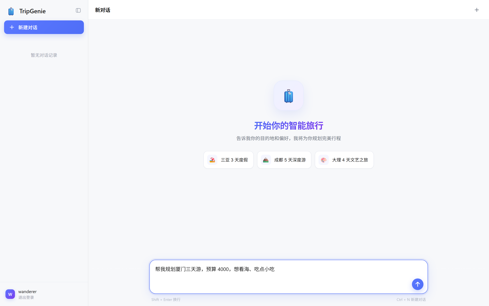
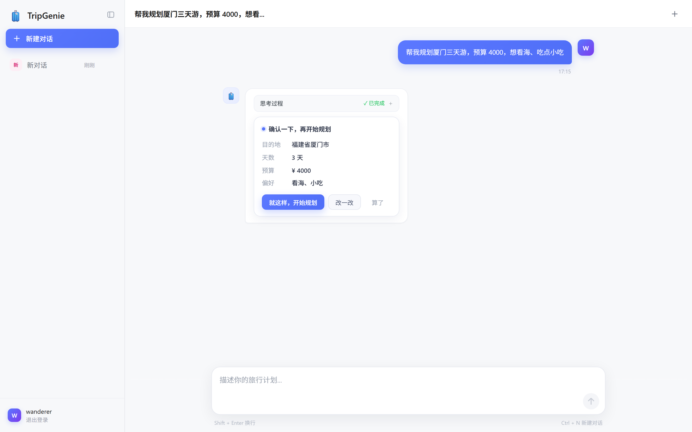
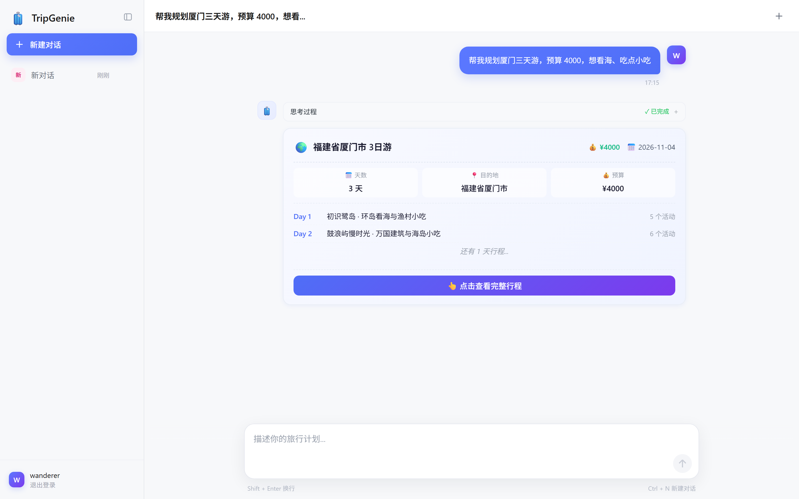
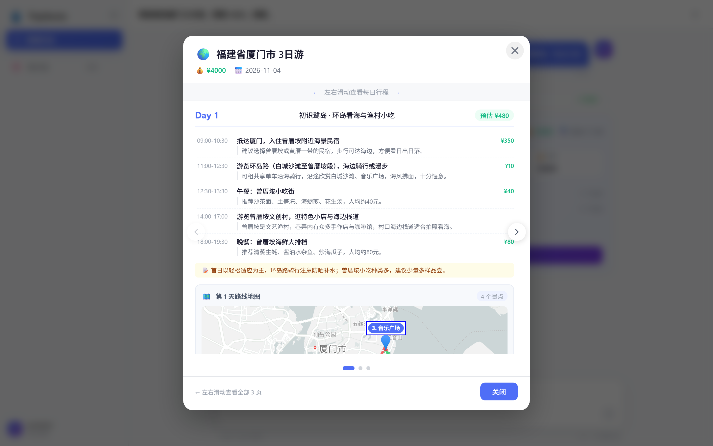
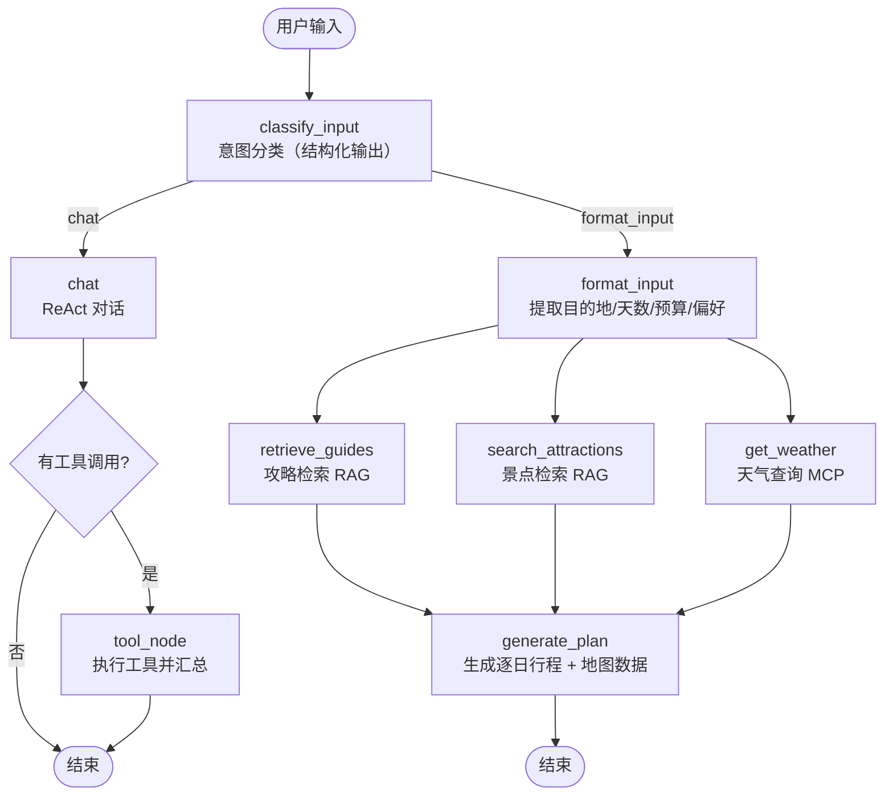

# TripGenie · 智能旅行规划助手

用一句自然语言描述旅行需求，系统自动完成 **需求解析 → 攻略检索 → 景点搜索 → 天气查询 → 生成逐日行程 → 渲染地图路线**，并以 SSE 流式输出实时展示 Agent 的中间思考过程。

个人项目，目标是完整跑通一个 LLM Agent 的工程化闭环：**工作流编排、工具接入、检索增强、流式输出、状态持久化**。

---

## 界面预览

一句话说清想怎么玩，剩下的交给它：



目的地或天数没给准时不会硬猜，先把条件摆出来让人拍板——错了就改，别浪费一次规划：



确认后并行检索攻略/景点/天气，生成行程并通过质检，再出卡片：



点开看逐日安排，每天附一张当天路线的地图（折线来自高德驾车路径规划，不是两点连直线）：



---

## 功能特性

### 1. 意图识别与双分支路由

入口节点用 LLM 的**结构化输出**（`with_structured_output` + `Literal["chat", "format_input"]`）判断用户意图，再由条件边路由，而不是靠关键词匹配堆 if-else。

- **chat 分支**：闲聊或单一工具诉求（天气、景点、交通、美食）。走标准 ReAct 循环——模型自主决定调用哪些工具，工具结果回灌后再由模型汇总成自然语言回复，单轮支持多工具并发调用。
- **format_input 分支**：多天行程规划这类复杂任务，进入下方的规划链路。

### 2. 行程规划：并行检索 + 汇聚生成

需求解析节点把自然语言拆成结构化字段（目的地 / 天数 / 预算 / 偏好），然后**扇出到三个互相独立的节点并行执行**：

- `retrieve_guides` —— 从攻略库做 RAG 检索
- `search_attractions` —— 从景点库做 RAG 检索
- `get_weather` —— 通过 MCP 工具查天气

三者全部完成后**汇聚**到 `generate_plan`，把检索结果、天气、预算等一起喂给模型，用流式方式生成结构化行程 JSON（逐日活动、时间、花费、备注、贴士）。

### 3. 行程地图可视化

生成的行程文本本身不含坐标，需要一次**反向结构化**：

1. 用 LLM 从行程中抽取"值得参观的景点/地标"，并标注它出现在第几天
2. 并发调用高德地理编码拿经纬度（城市名 + 景点名组合搜索以提高命中率，并发度见 `MAP_CONCURRENCY`）
3. 调用驾车路径规划生成路线，拿到 polyline、距离与耗时
4. 前端按天渲染独立地图：编号 marker + 彩色路线 + 距离/耗时列表

工程上处理了几个实际问题：**跨天不生成路线**（避免画出"第 1 天景点 → 第 2 天景点"的假路线）；MCP 返回格式在不同工具间不一致，做了多层兼容解析并在 JSON 解析失败时降级为正则提取；地理编码失败时回落到估算位置并标记 `approx`，前端用灰色区分。

### 4. MCP 协议接入外部工具

通过 `langchain-mcp-adapters` 的 `MultiServerMCPClient`，以 **stdio** 方式拉起两个 MCP Server：

| MCP Server | 用途 |
|---|---|
| `amap-mcp-server` | 高德地图：地理编码、路径规划 |
| `mcp-server-time` | 时间查询（本地时区 Asia/Shanghai） |

MCP 工具与自研工具（RAG 检索、天气查询）合并成统一工具集交给模型调度，并支持按名称屏蔽指定工具。新增工具只需改工具注册处，**不必改动工作流定义**。

### 5. 全链路流式输出与"思考链"

后端基于 `workflow.astream_events(version="v2")` 捕获节点级事件，包装成自定义 SSE 协议下发：

| 事件 | 含义 |
|---|---|
| `thread_id` | 会话 ID（新会话时由后端生成） |
| `node_start` / `node_end` | 某个工作流节点开始/结束 |
| `chunk` | 模型流式输出的文本片段 |
| `trip_plan` | 结构化的完整行程（含地图数据） |
| `done` / `error` | 结束或异常 |

前端不依赖任何 SSE 库，用 `fetch` + `ReadableStream` + `TextDecoder` 手工解析分帧（因为原生 `EventSource` 只支持 GET，无法带 JSON body）。节点事件被渲染成可折叠的"思考过程"时间线，文本片段进缓冲区后按固定速率平滑打印，避免网络抖动造成的一顿一顿。

### 6. 多轮会话与历史回放

- **图状态持久化**：LangGraph `AsyncSqliteSaver` 按 `thread_id` 做检查点，多轮对话能接上上下文
- **业务侧存储**：另建 SQLite 的 `sessions` / `messages` 表管理会话列表（含索引、级联删除、按首条用户消息自动生成会话名）
- **历史回放**：行程产生的地图数据以 JSON 存进消息表，重新打开历史会话时地图能原样恢复

### 7. 账号体系与数据隔离

- **登录门禁**：未登录时前端直接弹登录窗（遮罩 + 卡片，不可关闭），登录后才能发消息；令牌有效则刷新页面仍保持登录
- **密码存储**：`sha256` 预摘要后走 `bcrypt`（规避 bcrypt 的 72 字节上限），库里只有哈希
- **令牌**：JWT（HS256，默认 7 天），放 `localStorage`，前端所有请求统一注入 `Authorization: Bearer <token>`
- **会话隔离**：`sessions.user_id` 存真实用户 ID；列表只查自己的；读/改/删会话时校验归属，不是自己的**统一返回 404**（不是 403——403 会暴露"这个 thread_id 存在"）
- **越权防护**：`/api/chat/stream` 若收到别人的 `thread_id` 返回 403，无法借会话 ID 往别人对话里写消息
- **自动续期**：任意接口返回 401 → 清本地令牌 → 广播 `auth:expired` → 自动重新弹出登录窗

---

## 系统架构

### 工作流



### 技术栈

| 层次 | 技术 |
|---|---|
| Agent 编排 | LangGraph（StateGraph / 条件边 / 并行扇出 / Checkpointer） |
| 工具协议 | MCP（`langchain-mcp-adapters`，stdio transport） |
| 大模型 | DeepSeek（`deepseek-flash`，通过 OpenAI 兼容端点接入）；`with_structured_output` 做意图分类 |
| RAG | Chroma 向量库、`qwen3.7-text-embedding-flash`（百炼 OpenAI 兼容模式，1024 维）、Markdown 按标题层级分块 |
| 后端 | Python 3.12+、FastAPI、SSE、asyncio |
| 存储 | SQLite（业务库 + LangGraph 检查点） |
| 前端 | Vue 3（Composition API）、Vite、原生 ReadableStream 解析 SSE、高德地图 JS API |
| 外部服务 | 高德地图开放平台、天气 API |

### 目录结构

```
TripGenie/
├── requirements.txt
├── .env.example
├── backend/
│   ├── run.py                       # 启动入口（uvicorn）
│   └── app/
│       ├── main.py                  # FastAPI 应用、CORS、路由注册
│       ├── config.py                # 配置（统一读 .env）
│       ├── api/
│       │   ├── auth.py               # 注册 / 登录 / 当前用户
│       │   ├── chat.py               # SSE 流式对话接口
│       │   └── history.py            # 会话 / 消息接口（按登录用户隔离）
│       ├── core/
│       │   ├── langgraph_app.py     # 工作流图定义
│       │   ├── nodes/                # 图上的节点，一个文件一个职责
│       │   ├── prompts/              # 提示词，改文案只看这里
│       │   ├── llm.py                # 模型实例与 MCP 工具加载
│       │   ├── json_utils.py         # 模型输出的 JSON 容错解析
│       │   ├── logging.py            # 结构化日志 + trace_id 上下文
│       │   ├── metrics.py            # 节点耗时 / token / 工具调用统计
│       │   ├── agents.py             # 兼容门面：只做再导出，新代码别往这加
│       │   ├── state.py              # TripState 状态定义
│       │   ├── security.py           # 密码哈希、JWT、当前用户依赖
│       │   ├── tools.py              # 自研工具（RAG 检索、天气）
│       │   └── checkpointer.py       # LangGraph SQLite 检查点
│       ├── mcp/
│       │   └── client.py             # MCP Server 接入与工具合并
│       ├── rag/                     # 文档加载 / 分块 / 向量库 / 检索
│       ├── services/                 # 会话库、天气、高德接口、地图数据、折线抽稀
│       ├── models/                   # 请求 / 响应模型
│       └── data/                     # 攻略文档、向量库、城市编码表、会话数据库
└── frontend/
    ├── index.html
    ├── vite.config.js               # 含 /api 反向代理
    └── src/
        ├── App.vue                  # 侧边栏 + 主区域布局 + 登录门禁
        ├── views/ChatView.vue       # 对话主界面（SSE 解析、思考链）
        ├── components/chat/         # 行程卡片、详情弹窗、每日地图、思考链
        ├── components/auth/         # 登录 / 注册弹窗
        ├── composables/             # useSessions / useAuth（均为模块级单例）
        └── utils/api.js             # 统一注入 Bearer 令牌、401 处理
```

---

## 快速开始

### 环境要求

- **Python >= 3.12**
- **Node.js >= 18**
- **uvx**（用于拉起 MCP Server）：`pip install uv`
- 一个 DeepSeek API Key（[控制台](https://platform.deepseek.com/api_keys)）
- 一个阿里云百炼 API Key（**仅用于 RAG 向量化**，DeepSeek 不提供 embedding 接口）
- 两个高德地图 Key（[控制台](https://console.amap.com/dev/key/app)）：
  - **Web 端（JS API）** Key —— 前端渲染地图用，记得把 `localhost` 加进域名白名单
  - **Web 服务** Key —— 后端透传给 MCP，用于地理编码和路径规划

### 1. 安装后端依赖

```bash
git clone https://github.com/kkszw/TripGenie.git
cd TripGenie
pip install -r requirements.txt
```

> ⚠️ `requirements.txt` 目前还是空文件（待冻结）。如果沿用你现有的虚拟环境，切到 DeepSeek 后需要补装对话模型适配包：
> `pip install "langchain-openai>=0.2.0"`

### 2. 配置环境变量

```bash
cp .env.example .env          # Windows: copy .env.example .env
```

按 `.env` 里的注释填入真实值，其中：

| 变量 | 说明 |
|---|---|
| `DEEPSEEK_API_KEY` | DeepSeek API Key，对话模型用 |
| `DEEPSEEK_BASE_URL` | 固定 `https://api.deepseek.com` |
| `DEEPSEEK_MODEL` | `deepseek-flash`（默认）或 `deepseek-v4-pro` |
| `DEEPSEEK_THINKING` | `disabled`（默认）/ `enabled`，见下方说明 |
| `DASHSCOPE_API_KEY` | 百炼 API Key，**仅 RAG 向量化使用**（也可用 `EMBEDDING_API_KEY` 单独指定） |
| `EMBEDDING_MODEL` | 向量模型，默认 `qwen3.7-text-embedding-flash` |
| `EMBEDDING_DIMENSIONS` | 向量维度，可选 `256/512/768/1024`，默认 1024。改了必须重建向量库 |
| `EMBEDDING_COLLECTION` | Chroma collection 名，带模型标识；换模型时同步改，避免新老向量混库 |
| `EMBEDDING_BATCH_SIZE` | 单批文本条数，官方上限 20 |
| `LLM_TIMEOUT` | 单次 LLM 调用超时秒数，默认 120 |
| `AMAP_API_KEY` | 高德 **Web 服务** Key，会透传给 MCP Server |
| `MAP_POLYLINE_TOLERANCE_M` | 折线抽稀容差（米），默认 6。被删掉的点到保留折线的偏离不超过该值，所以路径形状不变；设 0 关闭几何抽稀。**不能留空**，留空启动会报 `ValueError` |
| `MAP_POLYLINE_MAX_POINTS` | 单段折线点数上限，默认 400。仅作兜底，正常抽稀后远低于该值；设 0 表示不限制 |
| `MAP_CONCURRENCY` | 地图阶段的并发度，默认 4（同时打给高德的请求数）。个人 Key QPS 低，调大反而会撞 10021 限流；设 1 退回串行 |
| `WEATHER_API_KEY` | 天气接口（可不填，天气节点失败不影响主流程） |
| `UVX_PATH` | uvx 可执行文件路径。**留空则自动探测** PATH 与当前虚拟环境 |
| `JWT_SECRET` | 登录令牌签名密钥。**必须固定一个随机串**，否则每次重启都会把所有人踢下线 |
| `LOG_LEVEL` | 日志级别，默认 `INFO`。排查细节时改 `DEBUG`（能看到每个景点的地理编码过程） |
| `LOG_DIR` | 日志目录，留空用 `backend/logs`（已在 `.gitignore` 里） |
| `RUN_LOG_ENABLED` | 是否把每次运行的摘要追加到 `logs/runs.jsonl`，默认 `true` |
| `DEEPSEEK_INPUT_PRICE` / `DEEPSEEK_OUTPUT_PRICE` | 模型单价（元 / 百万 token），**仅用于把 token 折算成金额**。留 0 就只统计 token |

> 生成 `JWT_SECRET`：`python -c "import secrets; print(secrets.token_urlsafe(48))"`，粘进 `.env` 即可。留空也能启动，但服务会用临时密钥并在控制台打印告警。

> **关于 `DEEPSEEK_THINKING`**：DeepSeek 的思考模式默认开启（effort=high）。本项目默认关闭，因为思考阶段 `content` 为空、前端 SSE 会长时间无输出，且带 `tools` 的请求要求回传 `reasoning_content`，而本项目的历史消息是从 SQLite 重建的纯文本，拿不到该字段。确实需要更强推理时再打开，并同步改造历史消息的存储方式。

前端另有一份：

```bash
cd frontend
cp .env.example .env
# 填入两个值：
#   VITE_AMAP_JS_KEY       高德「Web端(JS API)」Key（不是 Web 服务的那个）
#   VITE_AMAP_SECURITY_CODE 与之配对的安全密钥 securityJsCode（2021-12-02 后申请的 Key 必填）
```

> 两者类型不通用：`AMAP_API_KEY`（后端，Web 服务）不能用于浏览器；`VITE_AMAP_JS_KEY`（Web端 JS API）不能用于后端接口。地图脚本由 `src/utils/amap.js` 动态加载，加载失败会在卡片里直接显示原因，不再只留一个灰块。

### 3. 启动后端

```bash
cd backend
python run.py
```

服务监听 `http://localhost:8000`，接口文档见 `http://localhost:8000/docs`。

> 向量库与会话数据库统一放在 `backend/app/data/` 下，路径相对 `backend/app/` 解析，从哪个目录启动都指向同一份数据。

### 4. 初始化 RAG 向量库（首次运行必须）

```bash
cd backend
python -m app.rag.init_rag_database          # 清空旧库后重建（默认）
python -m app.rag.init_rag_database --keep   # 保留旧库，追加写入
```

会读取 `app/data/travel_guide/` 下的全部 Markdown 攻略，按标题层级分块后写入 Chroma。

> **换了 embedding 模型或改了维度，必须重跑本脚本。** 不同模型产出的向量不在同一语义空间，混在一个 collection 里不会报错，只会让检索结果静默变差。默认行为就是整库重建，`--keep` 仅用于追加语料。

### 5. 启动前端

```bash
cd frontend
npm install
npm run dev
```

访问 `http://localhost:5173`。Vite 已配置 `/api` 反向代理到 `localhost:8000`，无需额外跨域设置。

---

## 行程质量评测

`backend/evals/` 是一套端到端回归：跑 20 条真实请求走完整工作流，再用**独立实现的规则**判分。改提示词、调 RAG、换模型之后，跑一遍就知道有没有退化。

```bash
cd backend
python evals/run_evals.py                    # 全量，约 8 分钟
python evals/run_evals.py --only normal      # 只跑某一类
python evals/run_evals.py --case normal_dalian_3d   # 单条
python evals/run_evals.py --limit 3          # 冒烟
```

评测跑在临时 checkpoint 库（`backend/app/data/checkpoints/evals.db`）上，不碰你本地的会话记录。

### 判分原则

**只判结构，不判内容。** 不断言"第 1 天必须去星海广场"——模型每次给的景点不同，硬断言必然 flaky，最后只能不断改测试去迁就模型，测试也就失去意义。断言的是产品的承诺：三天就产出三天、每天有具体去处、不超预算、地图能画线、目的地不会串城。

判分逻辑在 `evals/checks.py` 里**独立重写**了一遍，不 import `app/core` 的任何东西。用被测代码判断被测对象，等于自己给自己批卷：真把那套规则改坏了，评测会跟着一起错，结果仍然全绿。

也不请 LLM 当裁判——让模型给自己打分，结果永远"看起来合理"，且不可复现。

### 20 条用例的构成

| 类型 | 条数 | 内容 |
|---|---|---|
| normal | 8 | 常规需求：明确城市 + 天数 + 预算 + 偏好 |
| edge | 5 | 边界：只给城市不给天数、只给天数不给城市、预算 500、单日、七天 |
| trap | 4 | 幻觉诱饵：冷门县城、虚构景点、只写"我家附近"、明说不要具体地名 |
| adversarial | 3 | 提示注入、超长输入、跨城混搭 |

覆盖的断言包括：天数对不对、每天活动数在 2~6、每天至少 N 处具体地点（排除餐饮住宿交通）、活动费不超预算、地图景点都在行程原文里出现过（防提取器编地点）、每段路线带 `day` 字段、折线点数大于 2（防"静默空折线"复发）、该触发人工确认的确实触发了、产出里没有漏出内部提示词。

后三条对应本项目真实踩过的三个坑：Day3 编造景点、折线静默为空、质检误杀合规行程。

### 当前基线

```
汇总 20/20（通过线 18/20，90%）→ PASS
单条平均 23 秒，全量约 7.5 分钟
```

这套评测上线后立刻发现两个真问题，都已修掉：

- `classify_input` 原来拿"多天旅游规划"当规划分支的判据，于是"大连一日游""我想去杭州玩"会在闲聊和规划之间摇摆——同一句话跑两次结果不同。判据改成"要不要排一天的安排"之后，5 组输入各跑 3 次全部稳定。
- `format_input` 遇到"云南七天"这种只给省份的需求，有时把目的地留空，直接掉进追问分支。改成"只有省份也能规划"之后，6 次提取全部非空。

拿它做回归要注意：LLM 有波动，单次失败不等于退化。实测同一批用例在不同运行里失败位置会漂移，所以通过线定在 90%——判断有没有退化，看连续两次的结果，别被一次红字带着走。

---

## 日志与度量

### 每次请求一个 trace_id

入口生成 8 位短码，通过 SSE 首帧下发给前端，同时写进本次请求的**每一行**日志。用户说"刚才失败了"时，让他报这个码，`grep` 一次就能捞出这次运行的完整过程：

```
18:40:12 INFO  [manual01b] services.map_data 坐标获取完成 total=11 precise=11 approx=0
18:40:14 INFO  [manual01b] api.chat 行程就绪 days=2 has_map=True
18:40:14 INFO  [manual01b] core.metrics 运行结束 generate_plan=8.6s generate_map=5.7s
                                  get_weather=5.3s status=ok total_ms=20340 llm_calls=4 tokens=7647+1643
```

控制台是给人看的彩色行，`logs/app.log` 是 JSON Lines 给机器查（按天轮转，保留 7 天）。

实现上必须用 `contextvars` 而不是模块级全局变量：SSE 是异步的，一次请求横跨多个 `await`，全局变量在并发下必然串号。三个字段（trace / thread / user）由 Formatter 自动注入，业务代码不用到处传参——这也是为什么 100 多处 `print` 换掉之后，调用点不需要改签名。

### 每次运行一行摘要

`logs/runs.jsonl`，一行一个 JSON：

```json
{"trace": "manual01b", "status": "ok", "total_ms": 20339.6,
 "nodes": {"generate_plan": {"ms": 8601, "pct": 42.3}, "generate_map": {"ms": 5742, "pct": 28.2}},
 "llm": {"calls": 4, "input_tokens": 7647, "output_tokens": 1643, "by_node": {...}},
 "tools": {"maps_geo": 9, "get_weather": 1},
 "extra": {"destination": "山东省青岛市", "days": 2}}
```

`status` 区分 `ok` / `interrupted`（等用户确认）/ `cancelled`（客户端断开）/ `failed`，四种出口都落盘——中断和取消是 `return` / `raise` 出去的，所以收尾放在 `finally` 里，少写一处就没有数据。

### 这套东西测出来的第一件事

一次"青岛两天"的实测分布（并发改造**前**）：

| 节点 | 耗时 | 占比 |
|---|---|---|
| generate_map | 16.2s | 58.5% |
| generate_plan | 7.6s | 27.3% |
| get_weather | 3.0s | 10.7% |
| 其余 4 个节点合计 | 2.5s | 9% |

结论很直接：**六成时间在地图节点，而它是一串串行的高德 HTTP 调用**——每个景点查一次坐标、
每两个相邻景点查一次路线，这些请求彼此没有任何依赖，却排着队等前一个返回。
之前只能靠临时脚本才测得出来，现在跑一次就有。

于是把这两段改成并发（`asyncio.gather` + 信号量限流，`MAP_CONCURRENCY` 默认 4）：

| | 改造前 | 改造后 |
|---|---|---|
| generate_map | 16.2s（58.5%） | 5.7s（28.2%） |
| 整轮规划 | 27.7s | 20.3s |

并发只改"什么时候发请求"，不改判定标准：`gather` 保证结果顺序与提交顺序一致，
所以景点和路线的排列与串行版完全相同（同一份输入跑五遍，输出逐字段相同）。
限流是必须的——个人 Key 的 QPS 很低，不设上限只会换来一串 `10021` 和退避重试，反而更慢。
MCP 兜底路径额外加了一把锁：它底下共用一条 stdio 会话，并发行为没有文档保证，
而这条本来就在 REST 失败时才走，串行化换确定性更划算。

### 取舍

- **不引 OpenTelemetry / Prometheus**：单进程、只想回答"这一次跑得怎么样"，攒在内存里结束时写一行 JSON，比拉一套 collector + exporter 直接。真要接链路追踪，`trace` 就是现成的锚点。
- **成本单价放配置不写死**：模型价格会变，写死在代码里就是定时炸弹。留 0 则只统计 token 不折算金额。
- **`scripts/` 和 `evals/` 的 `print` 保留**：那些是给人手动跑的进度条，变成日志反而难读。
- **`logs/` 不进仓库**：已在 `.gitignore`。

---


## API 接口

除 `/api/auth/register`、`/api/auth/login`、`/health` 外，所有接口都需要请求头 `Authorization: Bearer <token>`。

| 方法 | 路径 | 说明 |
|---|---|---|
| `POST` | `/api/auth/register` | 注册（用户名 + 密码），成功即返回令牌，不用再登录一次 |
| `POST` | `/api/auth/login` | 登录，返回令牌与用户信息 |
| `GET` | `/api/auth/me` | 用令牌换用户信息（前端刷新页面时校验令牌是否仍有效） |
| `POST` | `/api/chat/stream` | 发送消息，**SSE 流式**返回 Agent 响应 |
| `GET` | `/api/history/` | 获取**当前登录用户**的会话列表 |
| `POST` | `/api/history/sessions` | 新建会话（归属取自令牌） |
| `GET` | `/api/history/{thread_id}` | 获取会话详情及其全部消息（非本人返回 404） |
| `PUT` | `/api/history/sessions/{thread_id}` | 重命名会话（非本人返回 404） |
| `DELETE` | `/api/history/{thread_id}` | 删除会话（消息级联删除，非本人返回 404） |
| `GET` | `/health` | 健康检查 |

`/api/chat/stream` 请求体：

```json
{
  "thread_id": "可选，不传则后端新建并返回",
  "message": "帮我规划三亚3天度假，预算5000，喜欢海滩和海鲜",
  "context": {}
}
```

---

## 已知限制与后续计划

- **RAG 知识库只有 1 篇示例攻略**，检索效果受限；加载器已支持 Markdown 层级分块与 PDF，扩充语料即可
- **有测试，但没有 CI**：`backend/tests/` 覆盖折线抽稀的几何正确性，`backend/evals/` 是 20 条端到端评测；两者都靠手动触发，没接 GitHub Actions
- **暂无容器化部署**
- **账号体系是最小实现**：有注册/登录/令牌续期，但没有找回密码、改密、邮箱校验、限流（暴力破解防护），也没有管理员角色
- **令牌存 `localStorage`**：本项目没有 `v-html`、没有第三方脚本，实际 XSS 风险低；若要更严格应改为 HttpOnly Cookie + CSRF token
- **地图兜底坐标是全局配置**，理想做法是先解析目的地城市中心再作为回落点
